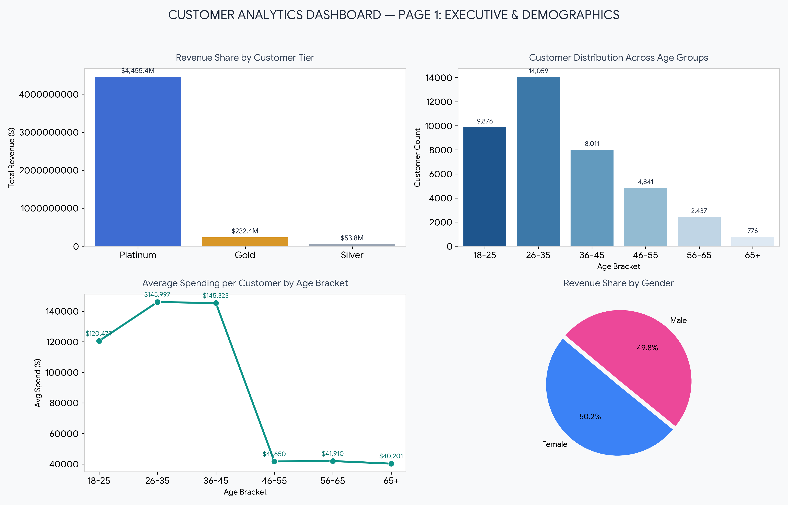

# 📊 Customer Analytics & Segmentation Report (2-Page Executive Dashboard)

## 📌 Project Overview
An end-to-end customer analytics project processing **40,000 customer records** to evaluate tier performance, demographic distributions, geographic revenue density, and order behavioral patterns.

## 📁 Repository Structure
- `customers.csv` — Cleaned raw dataset (40,000 records).
- `Dashboard_Page_1.png` — Executive KPI & Demographics View.
- `Dashboard_Page_2.png` — Geographic & Registration Velocity View.
- `Customer_Queries.sql` — SQL scripts for database queries and aggregations.

---

## 📊 Interactive Dashboard Previews

### Page 1: Executive KPI & Demographics

### Page 2: Geographic & Registration Trends

---

## 💡 Key Business Insights
1. **Tier Concentration:** Platinum members represent 68.3% of users but account for 94% of total revenue ($4.45B), yielding an Average Order Value of $31,341.
2. **Core Demographics:** Young professionals (26–35 years) form the primary revenue engine, spending an average of $145,997 per customer.
3. **Geographic Strategy:** Top performing states (UP, Rajasthan, Haryana) account for over $1.8B in combined revenue.
